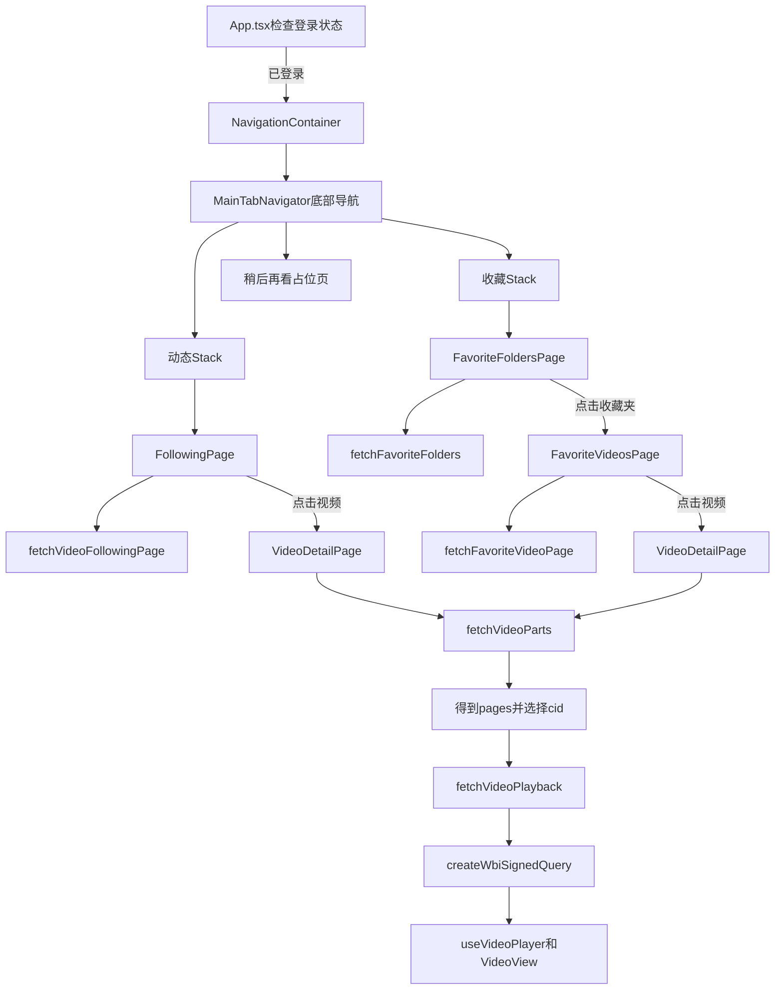

# 当前导航页面与视频播放实现说明

本文只解释当前项目已经存在的代码,不继续扩展功能.这里的两个主导航页面指已经完成的`动态`页面和`收藏`页面.`稍后再看`目前仍然是占位页面.

建议先建立一条总的认识:

1. React 组件负责描述界面.
2. Hook 保存状态并处理组件生命周期.
3. 独立的 TypeScript 文件负责调用 B站 API 和解析 JSON.
4. React Navigation 负责在页面之间传递参数.
5. `expo-video`拿到最终视频流 URL 后负责播放.

## 1. 整体调用关系



两条入口最终复用了同一个`VideoDetailPage`:

- 动态页传入动态视频对象.
- 收藏视频页传入收藏视频对象.
- 两种对象都有详情页需要的`bvid`,`title`,`cover`和`author`字段.
- 详情页不依赖列表接口提供`cid`,而是用`bvid`重新查询完整分P列表.

## 2. 启动阶段如何决定显示哪个页面

入口逻辑位于`src/App.tsx`.

### 2.1 `AppScreen`联合类型

```ts
type AppScreen = 'checking' | 'main' | 'login' | 'authenticated';
```

这表示`screen`只能取四个字符串之一.TypeScript 会阻止写入其他字符串.

- `checking`: 正在从安全存储读取登录信息.
- `main`: 没有登录信息,显示登录按钮页面.
- `login`: 显示 B站官方登录 WebView.
- `authenticated`: 登录完成,显示应用主导航.

### 2.2 `useState`保存当前界面状态

```ts
const [screen, setScreen] = useState<AppScreen>('checking');
```

`useState`返回两个值:

- `screen`是当前值.
- `setScreen`用于修改值.

调用`setScreen('authenticated')`后,React 会重新执行`App`组件,然后根据新的`screen`返回不同界面.

### 2.3 `useEffect`在组件出现后检查登录状态

```ts
useEffect(() => {
    // 异步读取 Cookie
}, []);
```

第二个参数是空数组`[]`,表示这个 Effect 在组件第一次挂载后运行一次.

Effect 本身不能直接声明成`async`,所以代码在内部定义`checkLoginState`,再用下面的方式启动:

```ts
void checkLoginState();
```

这里的`void`表示主动忽略返回的`Promise`,不是让函数变成同步函数.

`isMounted`用于避免异步读取结束时组件已经卸载,却仍然调用`setScreen`.Effect 返回的函数是清理函数,组件卸载时把`isMounted`改成`false`.

### 2.4 `NavigationContainer`的作用

```tsx
<NavigationContainer>
    <MainTabNavigator />
</NavigationContainer>
```

`NavigationContainer`来自`@react-navigation/native`.它保存全局导航状态,处理 Android 返回键,并把`navigation`和`route`能力传给内部导航器.

它通常只需要放在应用导航树最外层一次.

## 3. 底部导航和页面栈

导航定义位于`src/navigation/MainTabNavigator.tsx`.

当前同时使用两种导航器:

- Bottom Tab: 在`动态`,`收藏`,`稍后再看`之间切换.
- Native Stack: 在一个 Tab 内从列表进入下一级页面,并支持返回.

### 3.1 创建导航器

```ts
const HomeStack = createNativeStackNavigator<HomeStackParamList>();
const FavoritesStack = createNativeStackNavigator<FavoritesStackParamList>();
const Tab = createBottomTabNavigator<MainTabParamList>();
```

这些函数不会立刻渲染界面.它们返回带有`Navigator`和`Screen`组件的对象.

### 3.2 用 ParamList 约束路由参数

```ts
type HomeStackParamList = {
    Home: undefined;
    VideoDetail: {
        video: VideoFollowingItem;
    };
};
```

含义如下:

- 跳转到`Home`时不允许传参数.
- 跳转到`VideoDetail`时必须传`video`.
- `video`必须满足`VideoFollowingItem`结构.

例如下面是合法调用:

```ts
navigation.navigate('VideoDetail', { video });
```

如果路由名拼错,漏传`video`,或者传入错误类型,TypeScript 会在编译阶段提示.

### 3.3 `NativeStackScreenProps`提供页面参数类型

```ts
function HomeScreen({
    navigation,
}: NativeStackScreenProps<HomeStackParamList, 'Home'>) {
```

`NativeStackScreenProps`根据 ParamList 推导出:

- `navigation`: 能跳到哪些页面,每个页面要传什么参数.
- `route`: 当前页面收到的参数.

详情页读取参数的方式是:

```ts
route.params.video
```

返回上一页使用:

```ts
navigation.goBack();
```

### 3.4 为什么每个 Tab 内部还有一个 Stack

动态 Tab 的结构是:

```text
HomeNavigator
|- Home
`- VideoDetail
```

收藏 Tab 的结构是:

```text
FavoritesNavigator
|- FavoriteFolders
|- FavoriteVideos
`- VideoDetail
```

底部 Tab 包裹这些 Stack,因此进入详情页后仍然处于原来的 Tab 导航上下文.从动态进入详情页时返回动态列表,从收藏进入详情页时返回收藏夹视频列表.

如果只使用一个全局 Stack,就需要额外处理详情页返回到哪个来源.当前嵌套方式让每个 Tab 保存自己的页面历史.

### 3.5 为什么页面组件只接收回调

`FollowingPage`并不知道 React Navigation 的路由名称,它只接收:

```ts
type Props = {
    onVideoPress: (video: VideoFollowingItem) => void;
};
```

导航适配发生在`HomeScreen`中:

```tsx
<FollowingPage
    onVideoPress={(video) => {
        navigation.navigate('VideoDetail', { video });
    }}
/>
```

这样做的好处是页面只表达业务动作`点击了视频`,路由名称和跳转方式由导航层决定.收藏页也采用相同方式.

## 4. 动态主页面

动态页面主要涉及以下文件:

- `src/following/FollowingPage.tsx`: 页面状态和列表界面.
- `src/following/fetchVideoFollowing.ts`: 请求 API 和解析 JSON.
- `src/components/following/VideoFollowingCard.tsx`: 单个视频动态卡片.
- `src/types/following.ts`: 页面使用的数据类型.

### 4.1 输入,输出和可观察结果

输入:

- 安全存储中的登录 Cookie.
- 可选的 API 分页`offset`.

输出:

- `VideoFollowingPage`,其中包含视频数组,下一页偏移和诊断信息.

可观察结果:

- 初次进入时显示加载状态.
- 请求成功后显示视频动态卡片.
- 下拉可以刷新.
- 点击卡片进入视频详情.
- 请求失败时显示错误和重试按钮.

### 4.2 页面状态

`FollowingPage`使用多个`useState`分别保存不同意义的状态:

```ts
const [items, setItems] = useState<VideoFollowingItem[]>([]);
const [isLoading, setIsLoading] = useState(true);
const [isRefreshing, setIsRefreshing] = useState(false);
const [errorMessage, setErrorMessage] = useState<string | null>(null);
```

不要把`isLoading`和`isRefreshing`合并为一个值,因为它们对应不同界面:

- `isLoading`: 第一次进入时页面中央的加载动画.
- `isRefreshing`: 列表已经存在时的下拉刷新动画.

`errorMessage`允许是`string`或`null`.`null`表示当前没有错误.

### 4.3 `useCallback`保存请求函数

```ts
const loadFollowing = useCallback(async (refreshing: boolean) => {
    // 请求逻辑
}, []);
```

React 每次重新渲染组件时都会重新执行函数体.普通内部函数也会得到新的函数对象.`useCallback`在依赖没有变化时保留同一个函数对象.

这里它的直接作用是让下面的 Effect 依赖保持稳定:

```ts
useEffect(() => {
    void loadFollowing(false);
}, [loadFollowing]);
```

### 4.4 `useRef`保存当前请求控制器

```ts
const requestControllerRef = useRef<AbortController | null>(null);
```

`useRef`保存一个跨渲染存在的可变对象.修改`requestControllerRef.current`不会触发重新渲染.

它很适合保存请求控制器,因为控制器需要跨异步步骤存在,但不需要显示在界面上.

新请求开始前执行:

```ts
requestControllerRef.current?.abort();
```

`?.`是可选链.只有`current`不是`null`时才调用`abort()`.

这样可以取消旧请求.例如用户快速连续下拉刷新时,较早的响应不会覆盖较新的数据.

### 4.5 `AbortController`和`AbortSignal`

请求端把`controller.signal`传给业务函数,业务函数再传给`fetch`:

```ts
fetch(url, {
    signal,
});
```

调用`controller.abort()`后,对应`fetch`会结束并抛出名称为`AbortError`的错误.

代码专门过滤这种错误:

```ts
if (!isAbortError(error)) {
    setErrorMessage(getErrorMessage(error));
}
```

主动取消是正常生命周期行为,不应该作为网络错误显示给用户.

### 4.6 为什么`finally`还要比较控制器

```ts
if (requestControllerRef.current === controller) {
    setIsLoading(false);
    setIsRefreshing(false);
    requestControllerRef.current = null;
}
```

假设请求 A 被请求 B 取消.请求 A 的`finally`仍可能执行.如果 A 无条件清空`current`,就会错误地清除 B 的控制器.

比较对象身份后,只有当前请求才能结束当前加载状态.这是避免异步竞态的重要写法.

### 4.7 动态 API 请求

业务函数请求:

```text
GET /x/polymer/web-dynamic/v1/feed/all
```

主要查询参数:

| 参数 | 当前值 | 作用 |
| --- | --- | --- |
| `timezone_offset` | `-480` | 东八区对应的时区偏移 |
| `type` | `video` | 请求视频类型动态 |
| `page` | `1` | 当前接口调用使用的页参数 |
| `features` | `itemOpusStyle` | 请求对应的数据结构特性 |
| `offset` | 可选 | 请求后续页面时使用 |

请求前从完整 Cookie 中提取`SESSDATA=...`,GET 请求只发送这一项,不发送不需要的 Cookie.

### 4.8 为什么把外部 JSON 当成`unknown`

网络响应不受 TypeScript 控制.即使接口文档说`data`是对象,运行时也可能返回`null`,字符串或改变字段.

代码先用:

```ts
type JsonRecord = Record<string, unknown>;
```

然后通过`asRecord`,`readString`,`readNumber`逐层验证.例如:

```ts
const modules = asRecord(item?.modules);
const title = readString(archive?.title);
```

这种方式比直接写类型断言更安全.类型断言只告诉编译器相信开发者,不会验证真实 JSON.

### 4.9 只保留视频动态

接口返回多种动态结构.当前解析器要求:

```ts
major.type === 'MAJOR_TYPE_ARCHIVE'
```

然后从`major.archive`读取`bvid`,`title`,`cover`和时长.其他动态返回`null`,最后使用:

```ts
.filter((item): item is VideoFollowingItem => item !== null)
```

这里的返回类型`item is VideoFollowingItem`叫类型谓词.它告诉 TypeScript,过滤结束后的数组不再包含`null`.

### 4.10 `FlatList`如何显示动态

重要属性如下:

| 属性 | 作用 |
| --- | --- |
| `data` | 提供列表数据 |
| `keyExtractor` | 为每项提供稳定唯一键 |
| `renderItem` | 把一个数据对象渲染成组件 |
| `ListEmptyComponent` | 数据为空时显示的内容 |
| `ListHeaderComponent` | 在列表顶部显示非致命错误 |
| `refreshing` | 控制下拉刷新动画 |
| `onRefresh` | 用户触发下拉刷新时调用 |

`FlatList`比在`ScrollView`中直接`map`大量数据更适合长列表,因为它会虚拟化渲染,只保留屏幕附近的列表项.

### 4.11 `Pressable`和按压样式

卡片使用:

```tsx
<Pressable
    onPress={onPress}
    style={({ pressed }) => [
        styles.card,
        pressed && styles.cardPressed,
    ]}
>
```

`style`接收函数时可以得到`pressed`状态.数组中的`false`会被 React Native 忽略,所以未按下时只应用`styles.card`,按下时再叠加透明度和缩放样式.

## 5. 收藏主页面

收藏功能分两级:

1. `FavoriteFoldersPage`显示用户创建的收藏夹.
2. `FavoriteVideosPage`显示用户选择的收藏夹中的视频.

对应业务请求集中在`src/favorites/fetchFavorites.ts`.

### 5.1 收藏类型

```ts
export type FavoriteFolder = {
    id: number;
    title: string;
    mediaCount: number;
};
```

收藏视频在普通视频基础上增加收藏时间和秒数格式的时长:

```ts
export type FavoriteVideo = Omit<VideoFollowingItem, 'duration'> & {
    durationSeconds: number;
    favoriteAt: number;
};
```

`Omit<T, K>`是 TypeScript 工具类型.它复制`VideoFollowingItem`,但移除`duration`字段.原因是动态接口返回格式化后的时长字符串,收藏接口返回秒数,两者不能假装是完全相同的含义.

`FavoriteVideo`仍然拥有详情页需要的字段,因此可以传给接收`VideoFollowingItem`的导航回调.TypeScript 的结构类型系统关注对象是否具有所需字段,允许对象额外拥有`durationSeconds`和`favoriteAt`.

### 5.2 获取用户自己的收藏夹

请求地址:

```text
GET /x/v3/fav/folder/created/list-all?up_mid=<用户mid>
```

这里需要两个登录字段:

- `DedeUserID`: 只在本地读取它的值,作为`up_mid`查询参数.
- `SESSDATA`: 作为必要 Cookie 发送到接口.

代码不会解码或重新编码 Cookie 内容,也不会输出 Cookie 日志.

接口返回后只转换当前界面需要的数据:

```ts
return {
    id,
    title,
    mediaCount: readNumber(folder?.media_count) ?? 0,
};
```

这叫数据归一化.页面不需要知道 API 使用`media_count`,只使用项目内部统一的`mediaCount`.

### 5.3 收藏夹双列布局

`FavoriteFoldersPage`仍然使用`FlatList`,但增加:

```tsx
numColumns={2}
columnWrapperStyle={styles.folderRow}
```

`numColumns={2}`让列表按两列排列.`columnWrapperStyle`控制每一行两个元素的间距.每个收藏夹卡片显示标题和`mediaCount`.

点击卡片调用`onFolderPress(item)`,导航层再执行:

```ts
navigation.navigate('FavoriteVideos', { folder });
```

因此收藏视频页可以从`route.params.folder`直接得到收藏夹 ID,标题和总数.

### 5.4 获取收藏夹中的视频

请求地址:

```text
GET /x/v3/fav/resource/list
```

主要参数:

| 参数 | 当前值 | 作用 |
| --- | --- | --- |
| `media_id` | 收藏夹 ID | 指定收藏夹 |
| `pn` | 当前页码 | 从1开始 |
| `ps` | `20` | 每页20条 |
| `order` | `mtime` | 按收藏修改时间排序 |
| `type` | `0` | 当前收藏夹范围 |
| `tid` | `0` | 不限制分区 |
| `platform` | `web` | 使用 Web 接口模式 |

收藏接口可能使用`bvid`或`bv_id`,所以解析器提供兼容读取:

```ts
const bvid = readString(video?.bvid) ?? readString(video?.bv_id);
```

`??`是空值合并运算符.左边不是`null`或`undefined`时使用左边,否则读取右边.

### 5.5 收藏视频分页

`FavoriteVideosPage`额外保存:

```ts
const [page, setPage] = useState(0);
const [hasMore, setHasMore] = useState(true);
const [isLoadingMore, setIsLoadingMore] = useState(false);
```

列表接近底部时触发:

```ts
onEndReached={() => {
    if (hasMore && !isLoadingMore && !requestControllerRef.current) {
        void loadPage(page + 1, false);
    }
}}
```

这里的三个条件分别防止:

- 接口已经表示没有下一页时继续请求.
- 当前正在加载下一页时重复请求.
- 其他请求尚未结束时并发请求.

第一页直接替换旧数据,后续页追加数据:

```ts
if (targetPage === 1) {
    return nextPage.items;
}
```

追加前用`Set`记录已有 ID,避免接口页边界变化时出现重复视频.

如果分页失败,页面保存错误并把`hasMore`设为`false`,避免`onEndReached`反复自动重试.用户可以通过下拉刷新重新从第一页加载.

### 5.6 收藏视频为什么不用先补`cid`

收藏接口通常不保证提供普通视频的`cid`.当前列表点击后只把带`bvid`的视频摘要传给详情页.

详情页随后调用`fetchVideoParts(bvid, ...)`,从视频详情接口获得所有分P的`cid`.这样动态和收藏共用同一条可靠流程,收藏页不需要自己补`cid`.

## 6. 视频播放完整流程

视频播放由以下文件共同完成:

- `src/video/VideoDetailPage.tsx`: 页面状态,分P选择和播放器界面.
- `src/video/fetchVideoPlayback.ts`: 视频信息和播放 URL 请求.
- `src/tool/wbi.ts`: WBI 参数签名.

完整步骤是:

```text
列表中的VideoFollowingItem
        |
        | bvid
        v
/x/web-interface/view
        |
        | pages: [{ cid, page, part, duration }]
        v
选择一个cid
        |
        | bvid + cid + WBI签名
        v
/x/player/wbi/playurl
        |
        | durl[0].url或backup_url
        v
useVideoPlayer
        |
        v
VideoView
```

### 6.1 `bvid`和`cid`分别是什么

- `bvid`: 一个投稿视频的 BV 标识,例如一个多P视频整体共用一个`bvid`.
- `cid`: 视频内容分段的标识.多P视频的每个分P拥有不同`cid`.

只传`bvid`不能准确指定播放哪个分P.播放地址请求需要同时知道`bvid`和目标`cid`.

### 6.2 第一步: 获取分P列表

`fetchVideoParts`调用:

```text
GET /x/web-interface/view?bvid=<bvid>
```

从`data.pages`解析:

```ts
export type VideoPart = {
    cid: number;
    page: number;
    title: string;
    durationSeconds: number;
};
```

页面进入时把第一项设为默认选择:

```ts
setParts(nextParts);
setSelectedCid(nextParts[0].cid);
```

如果接口没有有效`pages`,代码会尝试使用`data.cid`构造一个名为`正片`的单P数据.这是对单P或不同响应结构的回退处理.

### 6.3 第二步: `selectedCid`驱动播放地址请求

详情页有两个分开的 Effect:

- Effect A 依赖`video.bvid`和`reloadKey`,负责获取分P.
- Effect B 依赖`selectedCid`和`video.bvid`,负责获取播放地址.

用户点击分P时只执行:

```ts
setSelectedCid(part.cid);
```

React 更新状态后,Effect B 因依赖变化自动运行,并调用:

```ts
fetchVideoPlayback(video.bvid, selectedCid, cookie, controller.signal)
```

这就是声明式状态的核心思路.点击事件不需要手动操作播放器的每一个步骤,它只改变`selectedCid`,后续行为由依赖该状态的 Effect 完成.

### 6.4 为什么切换分P时先`setPlayback(null)`

```ts
setPlayback(null);
setErrorMessage(null);
```

它会让旧播放器从界面树中卸载,页面暂时显示加载状态.新 URL 返回后再创建新的`VideoPlayer`.

这可以避免旧分P继续显示,也让`useVideoPlayer`对应的播放器实例有清晰的创建和释放边界.

### 6.5 WBI签名是什么

当前播放地址接口是:

```text
GET /x/player/wbi/playurl
```

除了普通参数,它还要求:

- `wts`: 当前 Unix 时间戳.
- `w_rid`: 根据查询参数和动态密钥计算出的 MD5 签名.

`createWbiSignedQuery`大致执行以下过程:

1. 请求`/x/web-interface/nav`.
2. 从`data.wbi_img.img_url`和`sub_url`提取两个文件名密钥.
3. 按固定索引表混合两个密钥,得到`mixinKey`.
4. 在播放参数中加入`wts`.
5. 删除不允许出现在值中的字符.
6. 按参数名排序并进行 URL 编码.
7. 计算`MD5(query + mixinKey)`得到`w_rid`.

`wbi.ts`会按天缓存`mixinKey`,避免每次播放或切换分P都请求一次`nav`接口.`pendingMixinKeyRequest`还会让同一时刻的多个调用共享一个正在进行的密钥请求.

当播放接口返回`-403`时,当前代码清空 WBI 密钥缓存:

```ts
clearWbiKeyCache();
```

它不会自动无限重试.用户重新加载时才会获取新密钥并再次请求.

### 6.6 当前播放参数

```ts
{
    bvid,
    cid,
    qn: 64,
    fnver: 0,
    fnval: 1,
    fourk: 1,
    platform: 'html5',
    high_quality: 1,
}
```

当前重点是`fnval: 1`和`platform: 'html5'`.这条路径请求单文件渐进式结果,然后从`data.durl[0]`读取 URL.

如果主 URL 不存在,代码尝试`backup_url[0]`.如果两者都不存在,会提示该视频可能只支持 DASH.

当前没有实现 DASH 音视频分离流的合并播放.DASH 通常分别返回视频流和音频流,需要播放器同时处理两条媒体轨道.这是当前实现明确存在的范围限制.

### 6.7 为什么播放 URL 还需要请求头

最终返回的`VideoPlayback`是:

```ts
{
    cid,
    url,
    headers: {
        Referer: 'https://www.bilibili.com/',
        'User-Agent': USER_AGENT,
    },
}
```

B站媒体 CDN 可能校验来源.因此播放器请求视频文件时仍要携带`Referer`和`User-Agent`.

注意这里没有把 Cookie 继续交给媒体播放器.获取播放地址时使用必要的`SESSDATA`,媒体 URL 请求只携带当前实现所需的来源头.

### 6.8 `useVideoPlayer`创建播放器

```ts
const player = useVideoPlayer(
    {
        uri: playback.url,
        headers: playback.headers,
        contentType: 'progressive',
        metadata: {
            title,
        },
    },
    (createdPlayer) => {
        createdPlayer.play();
    },
);
```

第一个参数是媒体源:

- `uri`: 最终播放 URL.
- `headers`: CDN 请求所需头.
- `contentType: 'progressive'`: 告诉播放器这是渐进式单文件媒体.
- `metadata.title`: 提供视频标题元数据.

第二个参数在播放器创建完成后运行.调用`createdPlayer.play()`实现自动开始播放.

`useVideoPlayer`由 React 生命周期管理播放器.组件卸载时,Hook 会处理播放器资源释放,比手动创建后忘记释放安全.

### 6.9 `useEvent`监听播放状态

```ts
const { status } = useEvent(player, 'statusChange', {
    status: player.status,
});
```

`useEvent`来自 Expo.它订阅播放器的`statusChange`事件,并把事件状态连接到 React 渲染流程.

后面的 Effect 观察`status`:

```ts
useEffect(() => {
    if (status === 'error') {
        onPlaybackError();
    }
}, [onPlaybackError, status]);
```

当原生播放器报告错误时,页面清空`playback`并显示重新加载按钮.

### 6.10 `VideoView`显示播放器

```tsx
<VideoView
    player={player}
    nativeControls
    contentFit='contain'
    fullscreenOptions={{
        enable: true,
        orientation: 'landscape',
    }}
/>
```

- `player`: 绑定前面创建的播放器实例.
- `nativeControls`: 使用系统提供的播放/暂停/进度等控制条.
- `contentFit='contain'`: 保持视频比例,完整放入播放器区域,可能出现黑边.
- `fullscreenOptions.enable`: 允许进入全屏.
- `orientation: 'landscape'`: 全屏时使用横屏方向.

播放器外层使用`aspectRatio: 16 / 9`,因此竖屏详情页中的播放器保持16:9.

### 6.11 横向分P选择条

只有`parts.length > 1`时显示分P区域.内部使用:

```tsx
<ScrollView horizontal showsHorizontalScrollIndicator={false}>
```

普通详情内容使用纵向`ScrollView`,分P区域嵌套一个横向`ScrollView`.因为两个滚动方向不同,用户可以左右浏览分P,同时上下滚动详情页.

每个分P按钮根据下面的条件显示选中样式:

```ts
const isSelected = part.cid === selectedCid;
```

`accessibilityState={{ selected: isSelected }}`还把选中状态提供给无障碍服务.

### 6.12 Android 返回键

详情页使用 React Native 的`BackHandler`:

```ts
const subscription = BackHandler.addEventListener('hardwareBackPress', () => {
    onBack();
    return true;
});
```

返回`true`表示事件已经由当前页面处理,不再继续向下传播.清理函数调用`subscription.remove()`,避免离开详情页后旧监听器继续生效.

## 7. 当前使用的依赖包

以下版本来自当前`package.json`.

| 依赖 | 当前用途 | 代码中的主要操作 | 是否包含原生能力 |
| --- | --- | --- | --- |
| `react` | 组件和状态管理 | `useState`,`useEffect`,`useCallback`,`useRef` | React Native 的基础运行时 |
| `react-native` | Android界面组件 | `View`,`Text`,`Image`,`FlatList`,`ScrollView`,`Pressable`,`StyleSheet`,`BackHandler` | 是 |
| `@react-navigation/native` | 导航容器和导航状态 | `NavigationContainer` | 依赖 React Native 导航环境 |
| `@react-navigation/bottom-tabs` | 底部主导航 | `createBottomTabNavigator` | 使用原生相关基础依赖 |
| `@react-navigation/native-stack` | 页面压栈和返回 | `createNativeStackNavigator`,`NativeStackScreenProps` | 是,基于原生屏幕能力 |
| `react-native-screens` | 为导航提供原生 Screen 容器 | 当前没有直接 import,由 React Navigation 使用 | 是 |
| `react-native-safe-area-context` | 为导航提供安全区域信息 | 当前没有直接 import,由导航包使用 | 是 |
| `expo-video` | 视频播放器 | `useVideoPlayer`,`VideoView` | 是 |
| `expo` | Expo运行时和事件 Hook | `useEvent` | 是 |
| `expo-secure-store` | 加密保存登录 Cookie | `setItemAsync`,`getItemAsync`,`deleteItemAsync` | 是 |
| `react-native-webview` | 加载 B站官方登录页 | `WebView` | 是 |
| `@preeternal/react-native-cookie-manager` | 从 WebView Cookie 存储读取登录 Cookie | `CookieManager.getCookieHeader` | 是 |
| `expo-dev-client` | 使用包含自定义原生模块的开发构建 | 运行时基础,业务代码不直接 import | 是 |
| `typescript` | 类型检查 | `corepack pnpm exec tsc --noEmit` | 否,开发依赖 |

### 7.1 React Native基础组件的操作方式

当前页面主要使用这些组件:

- `View`: 类似布局容器,默认使用 Flexbox.
- `Text`: 所有文本必须放在`Text`中.
- `Image`: 使用`source={{ uri: url }}`加载网络图片.
- `Pressable`: 处理点击和按压反馈.
- `FlatList`: 高效渲染长列表并支持刷新/触底.
- `ScrollView`: 渲染数量较少且需要整体滚动的内容.
- `ActivityIndicator`: 加载动画.
- `StyleSheet.create`: 集中声明 React Native 样式.

React Native 样式不是浏览器 CSS.常见差异包括:

- 属性使用驼峰形式,例如`backgroundColor`.
- 数字通常表示逻辑像素,不写`px`.
- 默认布局方向是纵向`column`.
- 阴影在 Android 主要由`elevation`控制,iOS使用`shadowColor`等属性.

### 7.2 安全存储如何操作

`src/auth/authCookie.ts`对`expo-secure-store`做了简单封装:

```ts
await SecureStore.setItemAsync(LOGIN_COOKIE_KEY, cookie);
const cookie = await SecureStore.getItemAsync(LOGIN_COOKIE_KEY);
await SecureStore.deleteItemAsync(LOGIN_COOKIE_KEY);
```

页面不直接操作存储键,统一调用`saveLoginCookie`,`getLoginCookie`和`clearLoginCookie`.这样以后更换存储实现时,业务页面不需要全部修改.

### 7.3 WebView和Cookie Manager如何配合

登录页通过`react-native-webview`显示 B站官方登录地址.用户登录后,WebView 的 Cookie 位于原生 Cookie 存储中.

页面的`onLoad`回调调用:

```ts
CookieManager.getCookieHeader('https://www.bilibili.com', true)
```

得到 Cookie header 字符串后,代码检查其中是否存在有效`SESSDATA`,再通过 SecureStore 保存.

`isCheckingCookie`防止 WebView 多次`onLoad`并发读取,`isLoginComplete`防止登录成功回调重复执行.

### 7.4 依赖管理命令

仓库指定了 pnpm 版本,因此统一通过 Corepack 调用,不要全局安装 pnpm.

恢复当前已有依赖:

```bash
corepack pnpm install
```

启动 Expo 开发服务:

```bash
corepack pnpm start
```

执行 TypeScript 检查:

```bash
corepack pnpm exec tsc --noEmit
```

也可以使用已有脚本:

```bash
corepack pnpm run typecheck
```

`--noEmit`表示只检查类型,不生成 JavaScript 文件.

当前登录和视频依赖包含原生代码.如果以后新增,删除或改变这些原生依赖版本,通常需要重新生成或重新构建 Android 开发客户端.只修改 TypeScript 页面代码一般不需要重新安装依赖.

## 8. 项目中常见的 TypeScript和JavaScript方法

### 8.1 数组处理

```ts
rawItems.map(parseVideoFollowingItem).filter(...)
```

- `map`: 把每个原始 JSON 转换为内部对象或`null`.
- `filter`: 删除无效项.
- `findIndex`: 查找当前分P的位置.
- `flatMap`: 解析分P时同时完成转换和删除无效项.
- `Set`: 去重或收集唯一类型.

### 8.2 字符串和数字处理

- `split(';')`: 把 Cookie header 拆成多个 Cookie 对.
- `trim()`: 删除两侧空白.
- `slice()`: 截取名称或值.
- `startsWith('//')`: 识别省略协议的图片或媒体 URL.
- `padStart(2, '0')`: 把分钟和秒补成两位.
- `Number.isFinite`: 排除`NaN`和无限值.
- `URLSearchParams`: 安全构造查询字符串.

### 8.3 异步错误处理

项目使用自定义错误类区分业务模块:

```ts
class FavoritesRequestError extends Error {
    readonly code?: number;
}
```

这样 UI 可以保留接口错误码和模块提供的中文消息,未知错误则显示统一兜底消息.

`try/catch/finally`的职责通常是:

- `try`: 读取登录信息并等待请求.
- `catch`: 忽略主动取消,保存真实错误.
- `finally`: 结束加载状态并清理控制器.

### 8.4 可选链和空值合并

```ts
const cover = normalizeImageUrl(archive?.cover);
const name = readString(upper?.name) ?? '未知UP主';
```

- `?.`在左侧为`null`或`undefined`时停止访问并返回`undefined`.
- `??`只在左侧为`null`或`undefined`时使用默认值.

它们适合解析不完全可信的 API JSON,但不能替代`asRecord`和类型检查.

## 9. 当前实现的边界

学习当前代码时需要知道它还没有覆盖以下内容:

- 动态请求已经解析`offset`和`hasMore`,但`FollowingPage`目前只显示第一次请求的结果,没有加载下一页.
- 收藏页只显示用户自己创建的收藏夹,不包含订阅的他人收藏夹.
- 收藏视频解析器会跳过缺少有效`bvid`,`title`或`cover`的失效内容.
- 视频播放只处理`durl`渐进式单文件,没有处理 DASH 音视频分离流.
- 当前没有清晰度选择,断点续播,播放进度上报和自动连播.
- 当前 WBI `-403`行为是清除缓存并等待用户重试,不会自动无限重试.
- 视频详情页目前只显示播放器,标题,UP主和分P选择条,其他详情功能还未实现.

这些不是依赖包做不到,而是当前阶段刻意保持最小实现,方便逐步理解每条数据和调用关系.

## 10. 推荐学习顺序

可以按下面顺序逐段对照代码:

1. 阅读`src/types/following.ts`和`src/types/favorites.ts`,先认识页面实际需要的数据形状.
2. 阅读`src/App.tsx`,理解`useState`和首次`useEffect`.
3. 阅读`src/navigation/MainTabNavigator.tsx`,画出 Tab 和两个 Stack.
4. 阅读`FollowingPage.tsx`,只关注加载/成功/错误三种界面状态.
5. 阅读`fetchVideoFollowing.ts`,跟随一条原始 JSON 变成`VideoFollowingItem`.
6. 阅读`FavoriteFoldersPage.tsx`和`FavoriteVideosPage.tsx`,比较普通加载和分页加载的区别.
7. 阅读`fetchFavorites.ts`,比较收藏夹数据与收藏视频数据的归一化.
8. 阅读`VideoDetailPage.tsx`,跟踪`selectedCid`改变后哪个 Effect 被触发.
9. 阅读`fetchVideoPlayback.ts`,理解分P信息请求和播放地址请求为什么必须分开.
10. 最后阅读`wbi.ts`,先掌握输入和输出,再研究内部 MD5 与密钥混合细节.

最重要的三条调用链是:

```text
状态变化 -> React重新渲染 -> 界面变化
```

```text
页面事件 -> 导航回调 -> navigation.navigate -> route.params
```

```text
bvid -> pages/cid -> WBI播放地址 -> useVideoPlayer -> VideoView
```

理解这三条链路后,当前动态页,收藏页和视频播放的大部分代码就能连成一个整体.
